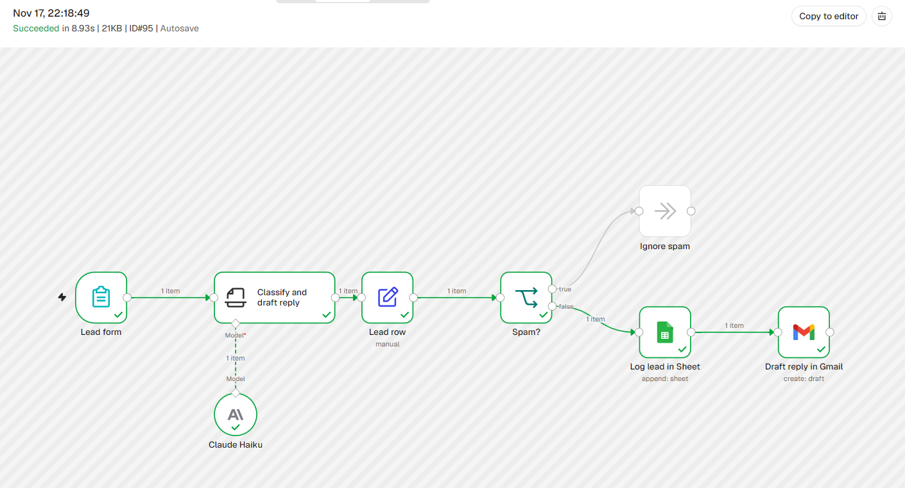

# Inbound lead triage in n8n (Claude + Google Sheets + Gmail)

An n8n workflow that takes a lead from a web form, has Claude classify it and write a reply, logs it in Google Sheets and leaves the reply as a Gmail draft for a person to check and send.

Built on the real price list and FAQ of Discard (discard.bg), my own NFC business card brand. It runs on a self-hosted n8n instance. It is a working demo, not Discard's live intake.

## What it does

1. **Lead form** (n8n Form Trigger): name, email, company, how many cards, message.
2. **Classify and draft reply** (Information Extractor with Claude Haiku): returns structured JSON.
   - `category`: team_order, single_order, design_request, support, partnership, spam
   - `priority`: hot, warm, cold
   - `language`, `estimated_cards`, a one-line English `summary`
   - `reply_subject` and `reply_draft` in the language the lead wrote in
3. **Lead row** (Set): flattens form fields and AI fields into one row.
4. **Spam?** (If): spam stops here.
5. **Log lead in Sheet** (Google Sheets, append).
6. **Draft reply in Gmail** (Gmail, create draft addressed to the lead). Nothing is sent automatically.

## Rules in the prompt

- Only facts from the price list. Questions it cannot answer (wholesale chips, reseller terms, exact team prices) get "the team will reply with details", never a guess.
- Team orders (5+ cards) never get a price. The reply asks for quantity, material and logo and promises a quote.
- Reply language comes from the message text, not from the sender's name or country.
- Bulgarian replies use the polite form, capitalised (Вие, Ви, Вашия).
- Plain text, 60-140 words, signed as the team, no personal names.

## Test results

20 hand-written leads in `test/leads.json`: 9 Bulgarian and 11 English, 3 of them spam, all six categories covered.

| run | result |
|---|---|
| first run, 1024 max tokens | 13/20 ran, 7 failed with "Model output doesn't fit required format" (Cyrillic replies were cut off) |
| 2048 max tokens + prompt fixes | **20/20 correct category**, right reply language, no banned characters, 20 leads in 28 s |
| end to end through the public form with Google nodes | 3/3: 2 rows in the Sheet, 2 Gmail drafts, spam dropped; one run takes about 9 s |

Problems found by reading the replies, and fixed in the prompt:
- a reply invented a fact ("we do not sell blank chips")
- an English message from a German sender got a German reply
- a Bulgarian reply used lowercase "вашия"

`test/run_tests.py` posts every lead to the live form, then reads each execution's output from n8n's Postgres database and scores it.

## Stack

- n8n 2.48.4 in Docker with Postgres 17, behind Traefik with a Let's Encrypt certificate, on a Linux VPS
- Claude Haiku through the n8n Anthropic Chat Model node
- Google Sheets and Gmail through a Google OAuth client
- `build.py` generates the workflow JSON, so the prompt and schema live in readable Python and are diffable

## Run it yourself

1. `python build.py` writes `workflow/discard-lead-triage.json`.
2. In n8n, import that file. Create three credentials: Anthropic API, Google Sheets OAuth2 and Gmail OAuth2. Point the Sheet node at a sheet with a `Leads` tab whose header row matches the Lead row field names.
3. Publish the workflow and open `/form/discard-lead`.

Swap the facts in `SYSTEM_PROMPT` for your own price list and the categories for your own funnel.
